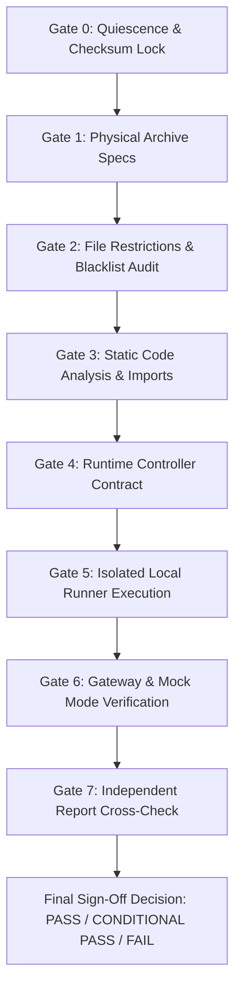

# ANTIGRAVITY Pre-Twist Audit Checklist & QA Gate Matrix

**Project:** PARTSINTEL — KSIT Hackmatrix Agentic AI (Team F67)  
**Role:** Independent QA and DevOps Engineer  
**Status:** **STANDBY / MONITORING** (Awaiting Codex completion of Pre-Twist Competitive Optimisation)  
**Target:** Final Pre-Twist Submission ZIP  

---

## Audit Execution Gates

---

## 1. Gate 0: Quiescence & Checksum Lock
- [ ] Confirm Codex has completed the competitive optimisation task.
- [ ] Confirm Codex has finalized the target ZIP archive.
- [ ] Record exact timestamp, byte count, and SHA-256 hash.
- [ ] Verify archive is quiescent (no active writes or process locks).

---

## 2. Gate 1: Physical Archive Specifications
- [ ] **Compressed Size:** <= 33,554,432 bytes (32 MiB).
- [ ] **Uncompressed Size:** <= 16,777,216 bytes (16 MiB).
- [ ] **File Count:** <= 100 entries.
- [ ] **Individual File Size:** <= 2,097,152 bytes (2 MiB) for every file.
- [ ] **Archive Integrity:** `zipfile.testzip()` returns `None` (0 corrupted headers or CRC mismatches).
- [ ] **Directory Layout:** 100% flat root layout (0 directory entries, no `/` or `\` in entry paths).
- [ ] **No Symlinks:** External attributes confirm no symbolic or hard links.
- [ ] **No Duplicates:** Unique filenames only across all archive members.

---

## 3. Gate 2: Official File Restrictions & Whitelist Audit
- [ ] **Allowed Extensions Only:** `.py`, `.json`, `.txt`, `.md`.
- [ ] **Required Entry Point:** `solution.py` present directly at archive root.
- [ ] **Blacklist Verification (Strict Zero-Tolerance):**
  - [ ] No macOS metadata: `__MACOSX`, `.DS_Store`.
  - [ ] No Python cache: `__pycache__`, `*.pyc`, `*.pyo`, `*.pyd`.
  - [ ] No virtual environments or packages: `venv/`, `.venv/`, `env/`, `node_modules/`.
  - [ ] No disallowed formats: `.csv`, `.ipynb`, `.pkl`, `.joblib`.
  - [ ] No dataset files: `training.json`, `practice.json`, `smoke.json`, `dataset_info.json`.
  - [ ] No prediction output files or evaluation logs.
  - [ ] No API keys, credentials, or environment files: `.env`, tokens, provider keys.
  - [ ] No temporary or editor swap files: `*.tmp`, `*.swp`, `*.swo`.

---

## 4. Gate 3: Static Code Analysis & Python Compatibility
- [ ] **Python Syntax:** All extracted `.py` files compile cleanly without syntax errors via `py_compile`.
- [ ] **Import Whitelist:** AST analysis verifies all imports are strictly standard library or local archive modules.
- [ ] **No Unauthorized Dependencies:** Zero unbundled 3rd-party dependencies.
- [ ] **Network Sandbox Conformance:** Zero direct networking client imports (`requests`, `urllib.request`, `socket`, `http.client`, `httpx`, `aiohttp`).
- [ ] **Python 3.12 Compatibility:** Confirm all language features and stdlib APIs conform to Python 3.12.14 specification.

---

## 5. Gate 4: Controller Contract Verification
- [ ] **Entry Point Signature:** `solution.decide(observation, state)` exists and is callable with 2 arguments.
- [ ] **Exact Return Schema:** Returns a dictionary containing **exactly** two keys: `{"action": dict, "state": dict}`.
- [ ] **Initial Action Contract:** First turn returns `op: "llm"` with properly structured `messages` array (1–24 messages, <= 48,000 bytes, `max_output_tokens` 16–2048).
- [ ] **Subsequent Action Contract:** World actions conform to exact schemas (`inspect`, `verify`, `clarify`, `dispatch`, `escalate`, `finish`).
- [ ] **Finite JSON Serializability:** Response serializes via `json.dumps(res, ensure_ascii=False, allow_nan=False)`.
- [ ] **Frame Size Constraint:** Serialized JSON payload is <= 1,048,576 bytes (1 MiB).
- [ ] **State Persistence:** Multi-turn state round-trips without mutation, data leakage, or uncontrolled memory growth.

---

## 6. Gate 5: Isolated Local Runner Execution (Extracted Code)
*All tests executed from a clean isolated directory (`.qa_zip_eval/`), not the development folder.*
- [ ] **Smoke Suite:** `local_runner.py` on `smoke.json` (--mock).
  - Target: Scored 2/2, 0 failures, 0 unsafe dispatches, 0 unavailable dispatches, 0 invalid actions.
- [ ] **Practice Suite:** `local_runner.py` on `practice.json` (--mock).
  - Target: Scored 12/12, 0 failures, 0 unsafe dispatches, 0 unavailable dispatches, 0 invalid actions.
- [ ] **Training Suite:** `local_runner.py` on `training.json` (--mock).
  - Target: Scored 40/40, 0 failures, 0 unsafe dispatches, 0 unavailable dispatches, 0 invalid actions.
- [ ] **Budget Compliance:** Mean tool expenditure <= 14 units; steps <= 60.
- [ ] **Local Checker:** `local_check.py` on `practice.json` passes request validation.

---

## 7. Gate 6: Gateway & Inference Verification
- [ ] Verify mock runs are explicitly documented as `mode: mock` / simulation-only.
- [ ] Check `run_gateway_evaluation.py` for safe skipping when `TEAM_GATEWAY_URL` and `TEAM_GATEWAY_TOKEN` are unset.
- [ ] Confirm no mock results are misattributed as genuine inference or official eligibility.
- [ ] Document gateway status as **UNCONFIGURED** or **VERIFIED** accordingly.

---

## 8. Gate 7: Independent Report Comparison & Discrepancy Analysis
- [ ] Cross-check measured file sizes, hash, and metrics against Codex's post-optimisation report.
- [ ] Confirm any optimisations (e.g. clarification routing, candidate ranking, tool spend reduction) match reported numbers.
- [ ] Identify and report any discrepancies between claimed and independently measured metrics.

---

## 9. Final QA Recommendation Matrix
- **PASS:** 100% of Gates 1–5 pass; genuine gateway inference verified; ready for official upload.
- **CONDITIONAL PASS:** 100% of Gates 1–5 pass; local mock execution verified; ready for Practice Upload 1 once gateway connection check is confirmed; official attempt held pending twist release.
- **FAIL:** Any critical violation in Gates 1–5 (e.g., size > 32 MiB, missing root `solution.py`, invalid action schema, unsafe dispatches, corrupted archive). Do NOT upload.

