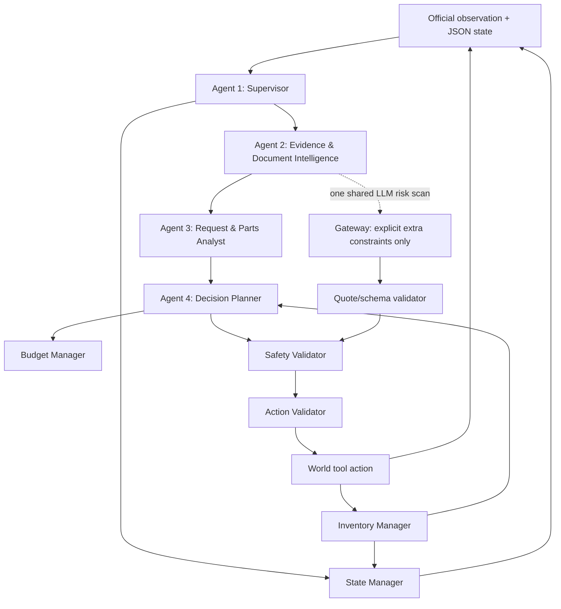

# PARTSINTEL Four-Agent Architecture

## Control and evidence flow

The dashed gateway pass is one call per case, not one call per agent. It is used to flag explicit constraints the deterministic parsers may not recognize. It cannot return a world action or alter extracted technical values. A warning is accepted only when its quote exactly occurs in the selected approved evidence; accepted warnings can only block a dispatch. Malformed output is ignored and the deterministic pipeline continues safely. This call uses the official `op: "llm"` relay protocol, one message under 48,000 serialized bytes, and 256 output tokens. The controller sends no additional model calls.

## Logical agents

### Agent 1 — Supervisor / Orchestrator (`supervisor.py`)

Owns the `decide(observation, state)` turn loop. It reconciles the prior tool result, runs the specialist pipeline, performs the one shared semantic risk scan, asks the planner for one next action, records that action as pending, and returns the exact `{"action": {}, "state": {}}` response. It synchronizes `decided_ticket_ids`, budget and steps from each observation. The planner reserves one world action for each undecided ticket before recommending another paid query.

### Agent 2 — Evidence & Document Intelligence (`document_intelligence.py`)

Selects current approved request/catalogue revisions as of the observation, rejects drafts, late old retries, duplicates and malformed metadata, and preserves evidence provenance and conflicts. Its state history is compact and JSON-compatible.

### Agent 3 — Request & Parts Analyst (`request_analyst.py`, `catalogue_parser.py`, `partsintel_common.py`)

Parses natural-language request and prose catalogue facts, normalizes mV/mW and connector aliases, preserves missing/ambiguous values, consumes only actual clarification tool replies, and computes exact voltage/connector and minimum-wattage compatibility. It emits candidate analysis and never decides stock or dispatch.

### Agent 4 — Decision Planner (`decision_planner.py`)

A deterministic planner selects the most constrained undecided ticket, ranks compatible candidates by current evidence/query cost and competing demand, requests clarification only when the missing minimum can change a match, and chooses inspect/verify/dispatch/escalate. It is a logical agent rather than a separate LLM call: these choices use frozen rules and shared structured evidence.

## Deterministic components and safety boundary

- `inventory_manager.py` tracks batch-open snapshots, inspect/verify results, stock conflicts, one-unit consumption, post-dispatch remaining stock, ticket decisions, and query spending. It treats inspect data as a fixed batch cache and marks a recorded dispatch's outcome unknown because the official response gives no fulfillment feedback.
- `stock_strategy.py` recommends inspect only for ordinary recent snapshots, verify for aged/changed/unknown/conflicting stock, and refuses to mark dispatch safe without known availability.
- `budget_manager.py` uses the official cost table (inspect 1, verify 2, clarify 2; dispatch/escalate/finish 0), the 14-unit budget, and 60-step cap. An invalid action is charged one unit while budget remains.
- `safety_validator.py` is the final dispatch gate. It requires an analyst candidate marked technically compatible, no request/part warning, an undecided ticket, no stock conflict, and known current availability of one.
- `action_validator.py` checks exact action keys, known IDs, undecided ticket status, published tool schema, budget, and remaining step count.
- `state_manager.py` stores JSON-safe state, pending actions, evidence history, clarification replies, warnings, inventory and decisions; controller responses are capped below the official 1 MiB frame limit.

An LLM suggestion cannot override any deterministic rejection. In particular, the model does not choose part IDs for dispatch, and model-produced action JSON is never forwarded to the world. A failed dispatch safety check falls back to escalation. Technical incompatibility and unavailable stock remain distinct: the controller dispatches only after both technical compatibility and stock confirmation.

## Runtime sequence

1. On the initial observation, resolve evidence and analysis, initialize state, and emit one bounded `op: "llm"` request.
2. On the relay response, parse only the warning schema and verify every quote against approved source text.
3. Recompute deterministic request/candidate analysis and sync inventory from the previous action result.
4. Ask Agent 4 for one query or irreversible decision. Validate the action, and pass any dispatch through the final safety gate.
5. On the next observation, reconcile the exact result and continue until every request is decided. Tool calls after the initial inference use no additional LLM requests.

## Scope and validation

The controller reads only observation fields and tool results. It does not use evaluator `world` labels, make network requests directly, or modify the simulator. Local mock runs validate controller wiring only; they do not demonstrate genuine gateway inference or official eligibility. Changed-condition behavior follows the live policy string and requires authoritative verify results.
# Post-twist rule handling

The post-twist copy keeps the same supervisor and deterministic safety gate. It adds three focused checks: request wattage is an inclusive minimum/maximum range when the observation carries the twist inventory manifest; stock is usable only from an approved opening-stock document bound to the manifest warehouse revision or from `verify`; and dispatch capacity is matched across all undecided requests before choosing a known-stock assignment. Unknown or missing range endpoints remain unresolved and trigger the scripted clarification when available.

The supervisor counts the UTF-8 bytes of each `messages` list using the exact `json.dumps(messages, ensure_ascii=False, allow_nan=False)` representation and keeps a per-case cumulative total capped at 48,000 bytes. The controller still makes one compact analysis call per case, so this cap is a guard rather than a reason to add agent calls.

The supplied twist packet currently contains zero new operating records, and its local simulator/data match the initial packet. The synthetic tests in the repository check the written rules; they do not substitute for later released records or post-twist portal grading.
